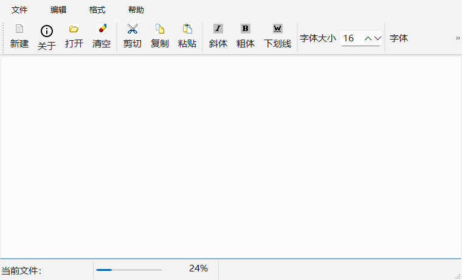
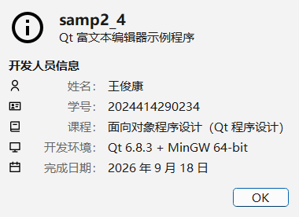

# QtCourse

《面向对象程序设计（Qt）》课程实验代码仓库。

## 一、本次实验内容

在课程示例程序 **samp2_4**（简易富文本编辑器）的工具栏上增加一个 **“关于”** 工具按钮，
点击后弹出 About 窗口，输出姓名、学号等开发者信息。

| 主窗口（工具栏第 2 个按钮为“关于”） | 点击后弹出的 About 窗口 |
| --- | --- |
|  |  |

## 二、开发环境

| 项目 | 版本 / 路径 |
| --- | --- |
| 操作系统 | Windows 10 / 11 64 位 |
| Qt | Qt 6.8.3（MinGW 64-bit）→ `D:\Qt\6.8.3\mingw_64` |
| 编译器 | MinGW-w64 GCC 13.1.0 → `D:\Qt\Tools\mingw1310_64` |
| IDE | Qt Creator 9.0.0 → `D:\Qt\Tools\QtCreator` |
| 构建方式 | qmake + mingw32-make（`.pro` 工程） |

## 三、目录结构

```
QtCourse/
├── README.md                     本说明文件
├── .gitignore                    忽略 Qt Creator / qmake 生成的中间文件
├── docs/
│   ├── GitHub同步步骤.md          把本地仓库同步到 GitHub 的详细步骤
│   ├── connect_github.ps1        一键创建远程仓库并推送（首次同步用）
│   ├── push_to_github.ps1        一键提交并推送的辅助脚本（以后每次用）
│   └── images/                   README 使用的截图
└── samp2_4/                      实验工程（qmake 工程）
    ├── samp2_4.pro               工程文件
    ├── main.cpp                  程序入口
    ├── qwmainwind.h              主窗口类声明（含“关于”槽函数）
    ├── qwmainwind.cpp            主窗口类实现（含 About 窗口代码）
    ├── qwmainwind.ui             主窗口界面文件（菜单、工具栏、Action）
    ├── res.qrc                   资源文件（图片 + 图标）
    ├── AppIcon.ico               程序图标
    ├── images/                   示例程序原有的工具栏位图
    └── icons/svg/                RemixIcon 图标（矢量 SVG）
```

> 说明：`ui_qwmainwind.h`、`moc_*.cpp`、`Makefile` 等都是 Qt 自动生成的中间文件，
> 已经写进 `.gitignore`，不需要（也不应该）提交到仓库。

## 四、编译与运行

### 方法 1：用 Qt Creator（推荐）

1. 打开 Qt Creator → `文件` → `打开文件或项目`，选择 `samp2_4/samp2_4.pro`；
2. 在 `项目` 页选择套件 **Desktop Qt 6.8.3 MinGW 64-bit**；
3. 按 `Ctrl + R`（或左下角绿色三角）编译并运行。

### 方法 2：命令行

```bat
set "PATH=D:\Qt\6.8.3\mingw_64\bin;D:\Qt\Tools\mingw1310_64\bin;%PATH%"
cd /d 本仓库路径\QtCourse
mkdir build-samp2_4 && cd build-samp2_4
qmake ..\samp2_4\samp2_4.pro
mingw32-make -j8
release\samp2_4.exe
```

## 五、本次修改说明

| 文件 | 修改内容 |
| --- | --- |
| `samp2_4/qwmainwind.ui` | 新增 Action `actAbout`（文字“关于”）、新增顶级菜单 `menu_4`（“帮助”），并把 `actAbout` 放到工具栏 `mainToolBar` 的第 2 个位置 |
| `samp2_4/qwmainwind.h` | 声明槽函数 `on_actAbout_triggered()` |
| `samp2_4/qwmainwind.cpp` | 实现 About 窗口；在文件顶部用 `DevInfo` 命名空间集中保存姓名、学号、课程等个人信息 |
| `samp2_4/res.qrc` | 新增 `/icons` 资源前缀，加入 RemixIcon 图标 |
| `samp2_4/icons/svg/` | 从 RemixIcon 图标库下载的 SVG 图标 |

关键点：

1. Action 命名为 `actAbout`，槽函数命名为 `on_actAbout_triggered()`，
   `ui->setupUi(this)` 里的 `connectSlotsByName()` 会自动把两者连接起来，不用手写 `connect`。
2. About 窗口是用代码创建的 `QDialog`（`QVBoxLayout` + `QGridLayout` + `QDialogButtonBox`），
   以模态方式 `exec()` 显示，点击 `OK` 后关闭。
3. **个人信息请在 `samp2_4/qwmainwind.cpp` 文件开头的 `DevInfo` 命名空间里修改**，
   About 窗口显示的就是那里面的内容。

### 图标来源

About 窗口的图标来自开源图标库 **RemixIcon**（Apache-2.0 许可）：
<https://github.com/Remix-Design/RemixIcon>

工程中直接使用 SVG 矢量图标（`:/icons/xxx.svg`），由 Qt 的 SVG 图像插件（QtSvg）渲染，
在任意缩放比例下都不会模糊。

## 六、同步到 GitHub

见 [`docs/GitHub同步步骤.md`](docs/GitHub同步步骤.md)。

## 七、提交记录

```bat
git log --oneline
```

1. `原始示例代码：samp2_4 富文本编辑器（未改动）`
2. `实验：为 samp2_4 增加“关于”工具按钮，弹出 About 窗口显示开发者信息`
